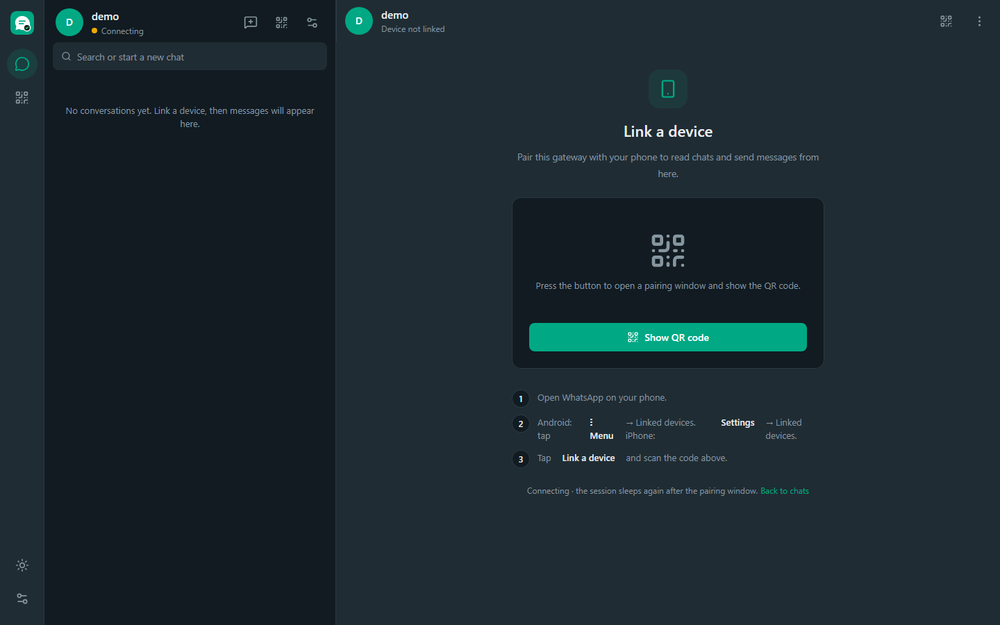
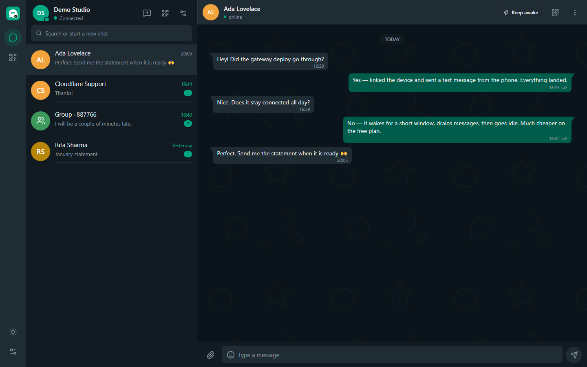
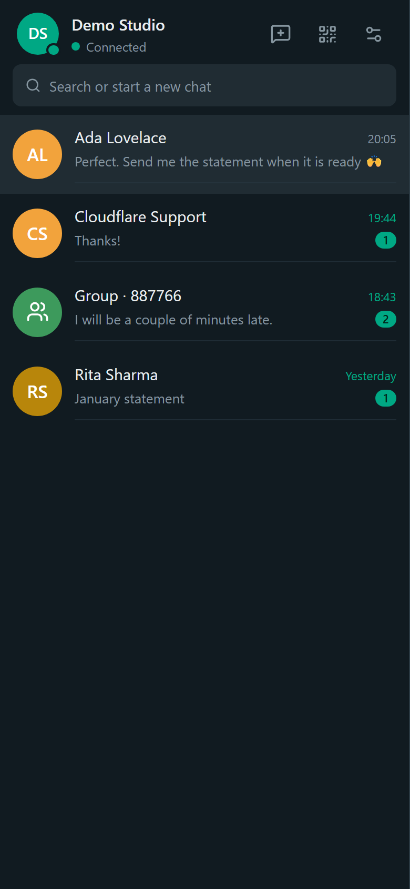

<p align="center">
  
</p>

<h1 align="center">OpenWA Worker</h1>

<p align="center">
  A WhatsApp gateway for Cloudflare Workers — link a device with a QR code, read chats, and send
  messages from a WhatsApp Web-style interface. No servers, no database, free-tier friendly.
</p>

<p align="center">
  <a href="https://deploy.workers.cloudflare.com/?url=https://github.com/dannybyarun/openwa-worker">
    
  </a>
</p>

## What this is

One Cloudflare Durable Object per WhatsApp session, running [`baileys`](https://github.com/WhiskeySockets/Baileys)
on workerd. The worker exposes a REST API, a WebSocket event stream, and a single-page UI that looks
and behaves like WhatsApp Web. Auth state, message history, and the puller cursor all live in the
session's Durable Object storage — there is no R2, D1, KV, or external database to provision.

**Verified against the real Cloudflare edge:** linking a device by QR and sending/receiving messages
works from a deployed Worker. See [Pairing on workerd](docs/architecture.md#pairing-on-workerd) for
the two workerd quirks the transport patch compensates for.

## Features

- **WhatsApp Web-style UI** — chat list, search, message bubbles with date separators, unread
  badges, QR pairing, dark/light themes, mobile layout. React 19, Vite, Tailwind CSS 4.
- **Sessions as Durable Objects** — create as many linked accounts as you need; each one owns its
  own socket, credentials, and history.
- **Lazy sockets** — a session connects for a short window (`/wake`, `/start`, `/send-text`) and
  closes again. An always-on DO would burn most of the free plan; this design doesn't.
- **REST + WebSocket API** — session CRUD, status, QR, history, keyed message cursor, text and
  document sending, live events. CORS-enabled.
- **Puller cursor** — `GET /messages?after=<seq>` returns unacked messages oldest-first with a
  monotonic `seq`, so a cron job, Apps Script, or a queue consumer can drain reliably.
- **Google Sheets drainer** — [`apps-script/`](apps-script/) turns a spreadsheet into an inbox and
  outbox with no extra infrastructure.
- **Optional webhooks** — `INBOUND_WEBHOOK_URL` POSTs every inbound message to your backend.
- **Password login** — the UI asks for `UI_PASSWORD` (falling back to `API_TOKEN`) and keeps a
  signed, expiring HttpOnly cookie. Nothing secret is stored in the browser, and **Sign out** drops
  the session.
- **Group names** — WhatsApp group chats show their real subject (cached while the session is
  connected) instead of `Group · 750265`.
- **Free-plan monitor** — **Free plan usage** in the app (or `GET /api/usage`) totals the wake
  counters, estimates Durable Object GB-s for the day, projects it against the 13,000 GB-s free
  allowance, and warns before you get close.
- **Draft with AI** — the ✨ button in a chat drafts a reply from that thread. It fills the composer;
  nothing is ever sent for you. The model is Workers AI by default, or any OpenAI-compatible endpoint
  you configure per session.
- **AI models & auto-reply per session** — pick the Workers AI model in Settings, or point the session
  at any OpenAI-compatible endpoint (`/chat/completions`) such as OpenAI, Groq, OpenRouter, Together,
  or a local Ollama/LM Studio — base URL, model name and key all set in the UI. Add extra
  instructions and optionally let the session answer incoming messages. Auto-reply is off by
  default, skips your own messages and groups (unless enabled), and is rate-limited per chat
  (cooldown plus a daily cap).
- **Links and media** — URLs in a message are clickable, and WhatsApp's own Open Graph card
  (title, description, thumbnail) is shown when present. Photos, video, voice notes, stickers and
  documents render a thumbnail with one-click open/download; the full file is fetched from
  WhatsApp on demand instead of bloating storage.
- **Embeddable website widget** — mint a token in Settings → Website widget and drop one `<script>`
  tag on any site for a "chat with us" bubble. Widget tokens are **send-only**: pinned to one
  account and one chat, origin-allowlisted if you want, capped at 50 messages/day, and they cannot
  read conversations. Generated `full` tokens work like `API_TOKEN` for scripts and can be revoked.
- **Token auth for scripts** — `API_TOKEN` also works as a bearer token (`X-API-Key`,
  `Authorization: Bearer`, or `?token=` for the events socket) for Apps Script and other clients.

## Screenshots

| Linking a device | Chats |
| --- | --- |
|  |  |

<p align="center">
  
</p>

> Captured from the built UI with a stubbed API, so the conversations above are samples, not a
> real account. The UI itself is the code in [`ui/`](ui/).

## Embed on your site

Deploy the worker, open **Settings → Website widget**, pick a project-wide chat, and copy the
snippet:

```html
<script src="https://your-worker.example.com/embed.js"
        data-token="owa_…"
        data-title="Chat with us"
        async></script>
```

Optional attributes: `data-greeting`, `data-accent="#00a884"`, `data-theme="dark"`,
`data-position="left"`, `data-worker` (if the script is served from a different origin).

The token is send-only and bound to that one chat. Add allowed origins to stop other sites from
using it, and revoke it from the same panel at any time. `POST /api/embed/send` is the bare API if
you would rather build your own form.

## Cost

This runs inside the Workers **free plan** for personal use:

- **Durable Objects (free plan):** 13,000 GB-s/day. A session that sleeps costs ~0; a 15-minute
  polling cadence with 4 sessions uses roughly 400 GB-s/day. An always-on DO would use ~10,800 GB-s
  per session and is explicitly not what this does.
- **Requests:** 100,000/day, shared with the UI.
- **Wake budget:** `DAILY_WAKE_LIMIT` (default 300 connects per session per UTC day) keeps a polling
  loop from running away. 5-minute polling = 288; see [`apps-script/README.md`](apps-script/README.md)
  for the cadence math against both free quotas.
- **Bundle:** ~7.5 MiB raw / ~1.5 MiB gzip, under the free plan's 3 MiB compressed limit.
- **Workers AI:** has its own daily Neuron allowance on the free plan. Only the **Draft with AI**
  button (and `POST /api/sessions/:id/ai`) spends it, so normal use costs nothing.

## Deploy

### One click

1. Click **Deploy to Cloudflare** above.
2. Set `API_TOKEN` when prompted (strongly recommended — without it the API is open to anyone with
   the URL). The UI's login password is `UI_PASSWORD` if you set one later, otherwise this token.
3. Open the Worker URL, sign in (or create a session if the API is open), press **Show QR code**, and
   scan it from **WhatsApp → Linked devices → Link a device**.
4. Send a test message from your phone — it appears in the chat list.

### With Wrangler

```bash
npm ci            # installs baileys + applies the two Workers patches (postinstall)
npm run deploy    # builds the UI, then wrangler deploy
npx wrangler secret put API_TOKEN     # scripts and the fallback login password
npx wrangler secret put UI_PASSWORD   # optional: a separate password for the browser UI
```

Prerequisites: Node 20.19+ (or 22.12+), a Cloudflare account, and `npx wrangler login`.
No bindings, buckets, or databases need to be created first — the Durable Object classes are
declared in `wrangler.toml` and created by the `v1` migration on first deploy.

Full guide, including custom domains and optional tuning: [`docs/deployment.md`](docs/deployment.md).

### Deploy with an AI agent

Paste this into an agent with terminal access (Claude Code, Codex, Cursor, …):

```text
Deploy OpenWA Worker from https://github.com/dannybyarun/openwa-worker to my Cloudflare account.

1. Read README.md, docs/deployment.md and wrangler.toml first.
2. Ask me for a strong password using a secret input. Never print it or put it in a command
   argument or a committed file.
3. Run `npm ci` (its postinstall patches baileys — do not skip or bypass it), then `npm run deploy`.
4. Set the password with `npx wrangler secret put UI_PASSWORD`. That also gates the REST API; the
   browser signs in with it.
5. Give me the workers.dev URL and tell me to sign in, create a session and scan the QR from
   WhatsApp → Linked devices. Do not try to pair WhatsApp for me.
```

## Local development

```bash
cp .dev.vars.example .dev.vars     # optional; empty secrets mean "no auth"
npm ci
npm run dev                        # builds the UI, then Miniflare on :8787
```

For UI hot reload, run the worker and Vite side by side:

```bash
npm run build                      # once, so the assets binding has something to serve
npm run dev:worker                 # wrangler dev on :8787
npm run dev:ui                     # Vite on :5173, proxies /api and /health to :8787
```

Checks:

```bash
npm test          # patch, auth, cursor, settings and token specs, no network
npm run typecheck  # worker + UI
```

## Documentation

- [Deployment and configuration](docs/deployment.md) — one-click, CLI, secrets, custom domains, budgets
- [API reference](docs/api.md) — every route, the cursor contract, WebSocket events, webhooks
- [Architecture](docs/architecture.md) — Durable Objects, lazy lifecycle, the baileys patch, pairing notes
- [Troubleshooting](docs/troubleshooting.md) — 401/429s, QR problems, send failures
- [Apps Script drainer](apps-script/README.md) — Sheets inbox/outbox, free-tier cadence math

## Limitations

- **One linked device per session.** A session is a WhatsApp linked device; use multiple sessions
  for multiple numbers.
- **Text and documents only.** Media download/upload (images, audio, video) is not implemented;
  inbound media messages appear as placeholders. Documents can be sent as base64 (≤8 MiB).
- **No delivery/read receipts.** The UI shows a sent tick, not real per-recipient receipts.
- **Latency is your poll interval.** While a session is idle the socket is closed; WhatsApp queues
  messages and delivers them on the next wake. Nothing is lost, but a webhook-driven real-time setup
  needs an always-on session, which costs free-tier budget.
- **Unofficial API.** This uses the WhatsApp Web protocol via baileys. Automation and unofficial
  clients are outside WhatsApp's terms of service; use a number you can afford to lose.
- **Not affiliated with WhatsApp or Meta.**

## License

[MIT](LICENSE)
